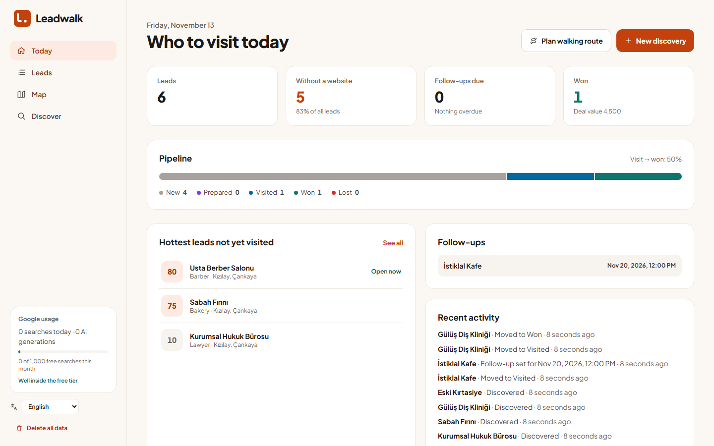

<p align="center">
  
</p>

<p align="center"><b>Walk in prepared.</b> · <i>Kapıdan hazırlıklı gir.</i></p>

<p align="center">
  <a href="https://github.com/furkankoykiran/Leadwalk/actions/workflows/ci.yml"></a>
  
  
  
  
</p>

**Leadwalk is an open-source, local-first field-sales workspace.** Pick a spot
on the map (or type an address) and it finds the businesses around you, ranks
who most needs what you build, writes the opener you walk in with, and tracks
every visit to a yes — on a dashboard, a list and a map. Everything runs on
your machine and lives in one SQLite file.

It is built for one workflow: a freelancer or small studio walking into local
shops with something concrete in hand, instead of a cold "can we talk about
your website?".



## What it does

1. **Discover** — drop a pin or type an address, choose a radius (500 m – 5 km)
   and an optional category. Leadwalk asks Google Places for the nearby
   businesses and keeps the ones you can actually walk into (no monuments,
   parks, closed or service-area-only places).
2. **Rank** — every lead gets an explainable **opportunity score** (0–100):
   no website, few reviews, a healthy rating, fits a booking system or QR menu,
   cash only, opening soon… Each point shows *why*. Free and deterministic — no
   AI call.
3. **Prepare** — one click and Gemini writes a short business profile, a warm,
   low-pressure door opener and 2–3 priced software ideas, grounded in the
   category, reviews, opening hours and service details Google reports. In
   English or Turkish, matching the UI.
4. **Walk** — plan a walking route through today's hottest leads and open it
   in Google Maps; call or WhatsApp in one tap.
5. **Track** — move leads through *New → Prepared → Visited → Won / Lost*, set
   follow-up dates, record deal values, keep notes and a full activity history.

### Highlights

- **Today dashboard** — KPIs, pipeline and visit→won conversion, hottest
  unvisited leads, follow-ups due/overdue, recent activity.
- **Leads list** — Turkish-aware search, quick filters (no website, hot, open
  now, few reviews, follow-up due), stage and category filters, sorting, bulk
  stage changes / route / delete, CSV export (Excel-ready UTF-8).
- **Map** — colour by stage or by opportunity, the areas you have searched,
  auto-framed to your leads.
- **English and Turkish**, picked automatically from the browser (override in
  the sidebar). **All dates and times in the browser's time zone.**
- **Light and dark** themes following the operating system.
- **Usage meter** — today's searches and generations, and month-to-date use of
  Google's free tier.
- **Local-first** — one SQLite file, no account, no telemetry, fonts
  self-hosted (no Google Fonts request).

## Getting started

Requires Node **22.12+** and npm **11+**.

```bash
git clone https://github.com/furkankoykiran/Leadwalk.git
cd Leadwalk
npm install
cp .env.example .env
```

Fill in the three keys in `.env` (see [API keys](#api-keys)), then:

```bash
npm run dev
```

Open <http://localhost:3000>.

### API keys

All three come from Google. None is needed to boot — each feature fails with a
clear message when its key is missing.

| Variable | Used for | Where |
|---|---|---|
| `GOOGLE_MAPS_API_KEY` (server) | Places API (New) + Geocoding API | Google Cloud Console → enable both APIs → create a key → restrict it to those two APIs |
| `NUXT_PUBLIC_GOOGLE_MAPS_BROWSER_KEY` (browser) | Maps JavaScript API (the maps) | Second key → enable Maps JavaScript API → restrict by HTTP referrer, e.g. `http://localhost:3000/*` |
| `GEMINI_API_KEY` | Profile, pitch and ideas | [Google AI Studio](https://aistudio.google.com/) → Get API key. A project without billing stays on the free tier. |

`.env` is gitignored. Never commit real keys — see [SECURITY.md](SECURITY.md).

## Google data, quotas and cost

**Only two actions call paid Google APIs: Discover and Prepare.** Browsing,
filtering, the dashboard, notes and the map's markers only read the local
database.

| Call | When | Billed as | Free per month |
|---|---|---|---|
| Places Nearby Search | each Discover | **Enterprise + Atmosphere** (because reviews are requested) | **1,000** |
| Geocoding | Discover by typed address | Essentials | 10,000 |
| Maps JavaScript (Dynamic Maps) | each map load | Essentials | 10,000 |
| Gemini | each Prepare | Free tier (rate-limited per day) | — |

A Places request is billed at the highest tier of any field it asks for.
Because reviews already put each search in the Enterprise + Atmosphere tier,
Leadwalk also requests everything else that tier includes **at no extra
cost**: business status (closed / opening soon), opening hours and time zone
(for "open now"), price level, international phone (WhatsApp), the Google Maps
link, Google's localised category label, neighbourhood/district, reservation /
delivery / dine-in / payment details, and Google's editorial and review
summaries where available. Photos are deliberately *not* requested: fetching
images is a separately billed SKU.

**Set your own ceiling.** In Cloud Console → APIs & Services → Places API →
Quotas, cap requests per day well under the free tier (e.g. 30/day ≈ 900/month),
and add a budget alert under Billing. The sidebar meter shows month-to-date
use against the 1,000 free searches.

Gemini calls retry transient overloads and fall back from `gemini-flash-latest`
to `gemini-flash-lite-latest` when the primary model is busy.

### Google Maps Platform terms — read this

Google's terms (Maps Platform ToS §3.2.3 and the Places service terms) allow
storing **place IDs** indefinitely and **coordinates for up to 30 days**, but
give no permission to cache other Places content (names, phone numbers,
reviews…) long-term. Leadwalk is a personal, local tool and currently keeps the
Google fields of a lead in its SQLite file so it works offline on the street.
If you build on it, review the terms for your use and consider keeping only
place IDs plus your own notes, re-fetching details on demand.

## Limitations

- **Single user, no authentication.** Anyone who can reach the running app can
  read and change all data. Run it on your own machine.
- **One file, no sync or backup.** `data/leads.db` (or an existing
  `data/prospectforge.db`) is the database. Export CSV for backups.
- **20 results per search** — Google's Nearby Search cap. Sweep dense areas
  with a smaller radius; the map shows what you have already covered.
- **AI output can be wrong.** Read the pitch before you use it.

## Scripts

| Command | What it does |
|---|---|
| `npm run dev` | Dev server on port 3000 |
| `npm run build` / `npm run preview` | Production build / serve it |
| `npm run typecheck` | `vue-tsc` over app, server, shared, unit and E2E tests |
| `npm run lint` | ESLint |
| `npm test` | Unit tests (Vitest) |
| `npm run test:e2e` | Browser E2E tests (Playwright), including `@live` tests that call Google and Gemini |
| `npm run test:e2e:offline` | E2E without the `@live` tests |
| `npm run brand:build` | Rebuild the brand kit in `brand/` and the favicon set |

E2E tests start their own dev server on port 3000 with a throwaway database
(`data/e2e.db`) — stop `npm run dev` first. First run: `npx playwright install chromium`.
CI runs lint, typecheck, unit tests and build on Node 22 and 24, plus the
offline E2E suite.

## Project structure

```
app/            Nuxt app (client-rendered)
  components/   BusinessDetail, RoutePlanner, LocationPicker, BrandMark, badges…
  composables/  i18n, formatting (browser time zone), usage meter, confirm dialog
  i18n/         en.ts, tr.ts — same keys, enforced by tests
  pages/        / (Today), /businesses, /businesses/[id], /map, /discover
  utils/        categories, lead helpers, walking route, map styles
server/
  api/          discover, process, businesses (CRUD, bulk, export, notes, activities), searches, usage
  utils/        SQLite (self-migrating), Places + mapping, Gemini, retries, localised errors
shared/         Types, opportunity score, brand (name, colours, mark geometry)
brand/          Brand kit: guidelines, tokens, logos, rasters, favicons — see brand/README.md
e2e/            Playwright tests + seed
test/           Unit tests
```

## Brand

Name, logo, colours, type and voice are documented in
[`brand/BRAND.md`](brand/BRAND.md); every asset is generated from
`shared/brand.ts` by `npm run brand:build`.

## Contributing

See [CONTRIBUTING.md](CONTRIBUTING.md) and the [Code of Conduct](CODE_OF_CONDUCT.md).

## License

[Apache-2.0](LICENSE). The Leadwalk name and logo are not covered by the
licence (see [NOTICE](NOTICE)) — forks are welcome under their own name.
