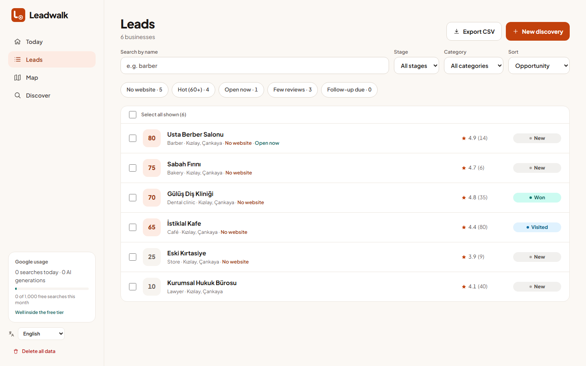
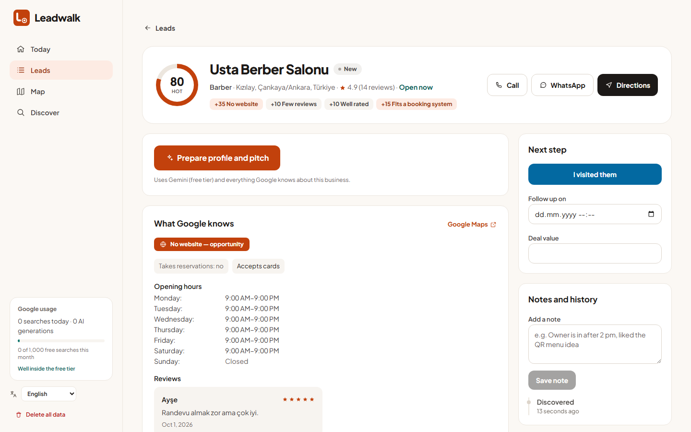

<p align="center">
  <a href="https://github.com/furkankoykiran/Leadwalk">
    <picture>
      <source media="(prefers-color-scheme: dark)" srcset="brand/svg/logo-horizontal-dark.svg">
      <source media="(prefers-color-scheme: light)" srcset="brand/svg/logo-horizontal.svg">
      
    </picture>
  </a>
</p>

<h3 align="center">Walk in prepared.</h3>

<p align="center">
  The open-source, local-first field-sales workspace: find the businesses around you,<br>
  rank who needs you most, and walk in with a tailored pitch.
</p>

<p align="center">
  <a href="#quick-start">Quick start</a> ·
  <a href="#features">Features</a> ·
  <a href="#google-data-quotas-and-cost">Cost</a> ·
  <a href="CONTRIBUTING.md">Contributing</a> ·
  <a href="SECURITY.md">Security</a> ·
  <a href="brand/BRAND.md">Brand</a>
</p>

<p align="center">
  <a href="https://github.com/furkankoykiran/Leadwalk/actions/workflows/ci.yml"></a>
  <a href="LICENSE"></a>
  <a href="https://nuxt.com"></a>
  <a href="#features"></a>
</p>

<p align="center"><b>English</b> · <a href="README.tr.md">Türkçe</a></p>

<p align="center">
  <picture>
    <source media="(prefers-color-scheme: dark)" srcset="docs/screenshots/en/dashboard-dark.png">
    <source media="(prefers-color-scheme: light)" srcset="docs/screenshots/en/dashboard-light.png">
    
  </picture>
</p>

## Why Leadwalk

Selling software to local shops is won on foot: you walk in, you ask for a
minute, and you either have something concrete for *that* business or you
don't. Lead finders give you a spreadsheet; CRMs give you a pipeline. Neither
tells you which café on this street most needs a booking system, or what to
say when you open the door.

Leadwalk does. It searches the area around you, scores every business on how
much it needs what you build, writes a warm, specific opener and 2–3 priced
ideas, plans the walk, and tracks every visit to a yes. It runs entirely on
your machine — one SQLite file, no account, no telemetry.

## Features

- **Discover** — drop a pin or type an address, pick a radius (500 m – 5 km)
  and a category. Leadwalk keeps only places you can walk into: no monuments,
  parks, permanently closed or service-area-only businesses.
- **Opportunity score** — 0–100, explainable and free: no website, few
  reviews, healthy rating, fits a booking system or QR menu, cash only,
  opening soon. Every point shows *why*.
- **Prepare** — Gemini writes a business profile, a low-pressure door opener
  and 2–3 priced software ideas from the category, reviews, opening hours and
  service details Google reports — in English or Turkish.
- **Today dashboard** — KPIs, pipeline and visit→won conversion, the hottest
  unvisited leads, follow-ups due or overdue, recent activity.
- **Lead management** — Turkish-aware search, quick filters (no website, hot,
  open now, few reviews, follow-up due), bulk stage changes, CSV export.
- **Walk** — a walking route through the leads you pick, opened in Google
  Maps; call or WhatsApp in one tap.
- **Track** — New → Prepared → Visited → Won / Lost, follow-up dates, deal
  values, notes and a full activity history.
- **Map** — colour by stage or by opportunity, with the areas you already searched.
- **Bilingual and local** — English and Turkish, picked from the browser; every
  date in the browser's time zone; light and dark themes follow the OS.

<details>
<summary><b>More screenshots</b></summary>
<br>

<picture>
  <source media="(prefers-color-scheme: dark)" srcset="docs/screenshots/en/leads-dark.png">
  
</picture>

<picture>
  <source media="(prefers-color-scheme: dark)" srcset="docs/screenshots/en/detail-dark.png">
  
</picture>

</details>

## Quick start

Requires **Node 22.12+** and **npm 11+**.

```bash
git clone https://github.com/furkankoykiran/Leadwalk.git
cd Leadwalk
npm install
cp .env.example .env
npm run dev
```

Open <http://localhost:3000>. The app boots without keys; each feature tells
you clearly which key it needs.

## Configuration

| Variable | Used for | How to get it |
|---|---|---|
| `GOOGLE_MAPS_API_KEY` | Places API (New) and Geocoding — **server only** | Google Cloud Console → enable both APIs → create a key → restrict it to those two APIs |
| `NUXT_PUBLIC_GOOGLE_MAPS_BROWSER_KEY` | Maps JavaScript API — the maps | A second key → enable Maps JavaScript API → restrict by HTTP referrer, e.g. `http://localhost:3000/*` |
| `GEMINI_API_KEY` | Profile, pitch and ideas | [Google AI Studio](https://aistudio.google.com/) → Get API key. A project without billing stays on the free tier. |
| `DATABASE_PATH` | Optional SQLite location | Defaults to `data/leads.db` |

`.env` is gitignored. Never commit real keys — see [SECURITY.md](SECURITY.md).

## Google data, quotas and cost

Only **Discover** and **Prepare** call paid Google APIs. Browsing, filtering,
the dashboard, notes and the map's markers read the local database.

| Call | When | Billed as | Free per month |
|---|---|---|---|
| Places Nearby Search | each Discover | **Enterprise + Atmosphere** (reviews are requested) | **1,000** |
| Geocoding | Discover by typed address | Essentials | 10,000 |
| Maps JavaScript | each map load | Essentials | 10,000 |
| Gemini | each Prepare | free tier, rate-limited daily | — |

A Places request is billed at the highest tier of any field it asks for.
Because reviews already put every search in Enterprise + Atmosphere, Leadwalk
requests everything else that tier includes **at no extra cost**: business
status, opening hours and time zone, price level, international phone, the
Maps link, Google's localised category label, neighbourhood, reservation /
delivery / payment details and Google's summaries where available. Photos are
not requested — images are a separately billed SKU.

Cap your spend in Cloud Console → Places API → **Quotas** (e.g. 30 requests a
day ≈ 900 a month) and add a budget alert. The sidebar shows this month's use
against the 1,000 free searches.

> [!IMPORTANT]
> Google's Maps Platform terms (§3.2.3 and the Places service terms) allow
> storing **place IDs** indefinitely and **coordinates for up to 30 days**,
> but give no licence to cache other Places content long-term. Leadwalk keeps
> a lead's Google fields locally so it works offline on the street. If you
> build on it, review the terms for your use; the compliant pattern is to keep
> place IDs plus your own notes and re-fetch details on demand.

## Tech stack

- [Nuxt 4](https://nuxt.com) (Vue 3, TypeScript) — client-rendered app and Nitro API
- [Tailwind CSS 4](https://tailwindcss.com) — design tokens for light and dark
- [SQLite](https://sqlite.org) via [better-sqlite3](https://github.com/WiseLibs/better-sqlite3) — one self-migrating file
- [Google Places API (New)](https://developers.google.com/maps/documentation/places/web-service), Geocoding and Maps JavaScript
- [Gemini API](https://ai.google.dev/) — `gemini-flash-latest`, falling back to `gemini-flash-lite-latest` when busy
- [Vitest](https://vitest.dev) and [Playwright](https://playwright.dev) — unit and end-to-end tests

## Testing

```bash
npm test                  # unit tests
npm run test:e2e:offline  # browser E2E against a throwaway database
npm run test:e2e          # includes @live tests that call Google and Gemini
```

E2E starts its own server on port 3000 with `data/e2e.db` — stop `npm run dev`
first, and run `npx playwright install chromium` once. CI runs lint, typecheck,
unit tests and the build on Node 22 and 24, plus the offline E2E suite.

<details>
<summary><b>All scripts</b></summary>

| Command | What it does |
|---|---|
| `npm run dev` | Dev server on port 3000 |
| `npm run build` / `npm run preview` | Production build / serve it |
| `npm run typecheck` | `vue-tsc` over app, server, shared and tests |
| `npm run lint` / `npm run lint:fix` | ESLint |
| `npm test` | Vitest unit tests |
| `npm run test:e2e` / `test:e2e:offline` | Playwright E2E, with or without live API tests |
| `npm run docs:screenshots` | Regenerate the README screenshots from seed data |
| `npm run brand:build` | Rebuild the brand kit and favicon set |

</details>

## Limitations

- **Single user, no authentication.** Anyone who can reach the app can read
  and change everything. Run it on your own machine.
- **One file, no sync.** Export CSV for backups.
- **20 results per search** (Google's cap). Sweep dense areas with a smaller
  radius; the map shows what you have covered.
- **AI output can be wrong.** Read the pitch before you use it.

## Contributing

Issues and pull requests are welcome — start with [CONTRIBUTING.md](CONTRIBUTING.md)
(including how to keep the Turkish translations in step) and the
[Code of Conduct](CODE_OF_CONDUCT.md). Security reports go through
[SECURITY.md](SECURITY.md), not public issues.

## License and brand

Code: [Apache-2.0](LICENSE). The Leadwalk name and logo are not covered by the
licence (see [NOTICE](NOTICE) and [brand/BRAND.md](brand/BRAND.md)) — forks are
welcome under their own name.
