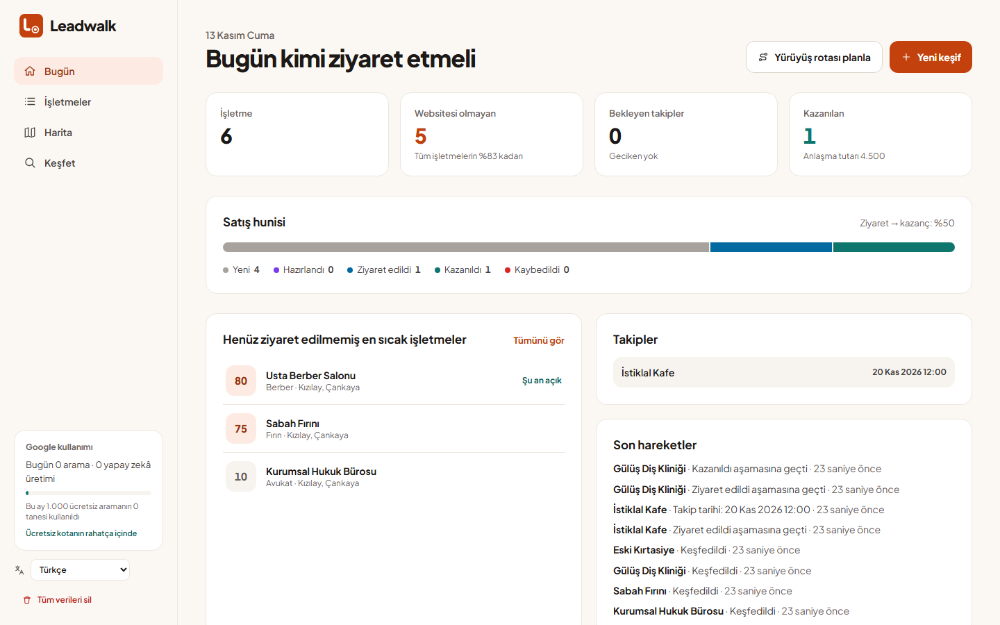
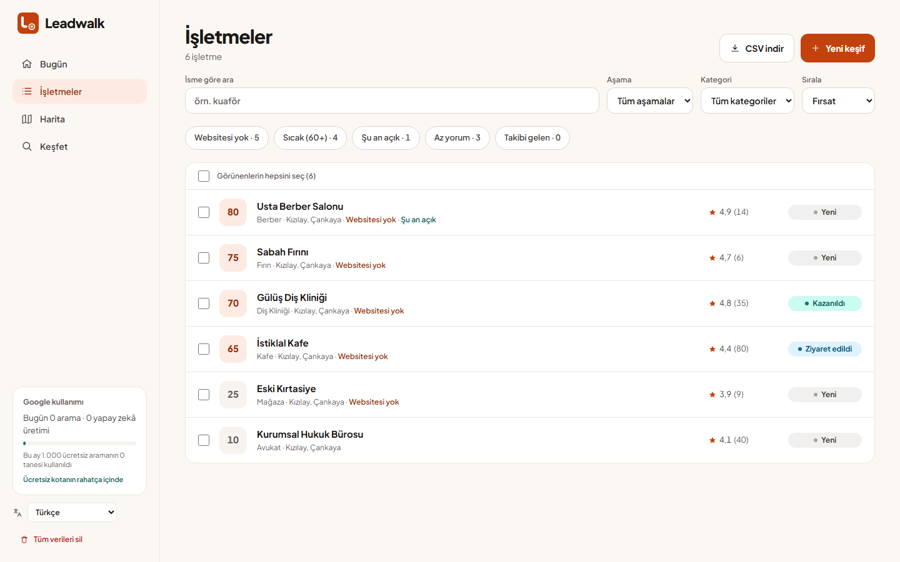
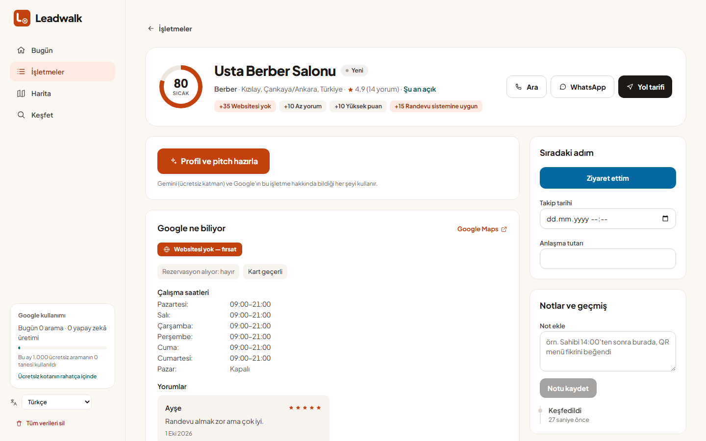

<!-- translated-from: README.md — İngilizce sürüm değiştiğinde bu dosyayı da güncelleyin. -->
<p align="center">
  <a href="https://github.com/furkankoykiran/Leadwalk">
    <picture>
      <source media="(prefers-color-scheme: dark)" srcset="brand/svg/logo-horizontal-dark.svg">
      <source media="(prefers-color-scheme: light)" srcset="brand/svg/logo-horizontal.svg">
      
    </picture>
  </a>
</p>

<h3 align="center">Kapıdan hazırlıklı gir.</h3>

<p align="center">
  Açık kaynak, yerel-öncelikli saha satış çalışma alanı: çevrendeki işletmeleri bul,<br>
  sana en çok kimin ihtiyacı olduğunu sırala ve ona özel bir konuşmayla içeri gir.
</p>

<p align="center">
  <a href="#hızlı-başlangıç">Hızlı başlangıç</a> ·
  <a href="#özellikler">Özellikler</a> ·
  <a href="#google-verisi-kotalar-ve-maliyet">Maliyet</a> ·
  <a href="CONTRIBUTING.md">Katkı</a> ·
  <a href="SECURITY.md">Güvenlik</a> ·
  <a href="brand/BRAND.md">Marka</a>
</p>

<p align="center">
  <a href="https://github.com/furkankoykiran/Leadwalk/actions/workflows/ci.yml"></a>
  <a href="LICENSE"></a>
  <a href="https://nuxt.com"></a>
  <a href="#özellikler"></a>
</p>

<p align="center"><a href="README.md">English</a> · <b>Türkçe</b></p>

> [!NOTE]
> Bu çeviri İngilizce sürümün gerisinde kalabilir. Esas metin [README.md](README.md) dosyasıdır.

<p align="center">
  <picture>
    <source media="(prefers-color-scheme: dark)" srcset="docs/screenshots/tr/dashboard-dark.png">
    <source media="(prefers-color-scheme: light)" srcset="docs/screenshots/tr/dashboard-light.png">
    
  </picture>
</p>

## Neden Leadwalk

Yerel esnafa yazılım satmak sokakta kazanılır: içeri girersin, bir dakika
istersin ve ya *o* işletme için somut bir önerin vardır ya da yoktur. Müşteri
adayı bulucular sana bir tablo verir, CRM'ler bir satış hunisi. İkisi de bu
sokaktaki hangi kafenin bir rezervasyon sistemine en çok ihtiyacı olduğunu ya
da kapıyı açtığında ne söyleyeceğini söylemez.

Leadwalk söyler. Çevrendeki bölgeyi arar, her işletmeyi senin yaptığın şeye ne
kadar ihtiyaç duyduğuna göre puanlar, sıcak ve somut bir açılış konuşması ile
fiyatlandırılmış 2–3 fikir yazar, yürüyüş rotanı planlar ve her ziyareti "evet"e
kadar takip eder. Tamamen kendi bilgisayarında çalışır: tek bir SQLite dosyası,
hesap yok, telemetri yok.

## Özellikler

- **Keşfet** — haritaya pin bırak ya da adres yaz, yarıçap (500 m – 5 km) ve
  kategori seç. Leadwalk yalnızca içine girilebilecek yerleri tutar: anıt,
  park, kalıcı olarak kapanmış ya da yalnızca hizmet bölgesi olan işletmeler
  elenir.
- **Fırsat skoru** — 0–100, açıklanabilir ve ücretsiz: websitesi yok, az yorum,
  sağlıklı puan, randevu sistemine ya da QR menüye uygun, yalnızca nakit,
  yakında açılıyor. Her puanın *nedeni* görünür.
- **Hazırla** — Gemini; kategori, yorumlar, çalışma saatleri ve Google'ın
  bildirdiği hizmet bilgilerinden bir işletme profili, baskısız bir açılış
  konuşması ve fiyatlandırılmış 2–3 yazılım fikri yazar — Türkçe ya da İngilizce.
- **Bugün panosu** — temel göstergeler, satış hunisi ve ziyaret → kazanç oranı,
  henüz ziyaret edilmemiş en sıcak işletmeler, zamanı gelen ya da geciken
  takipler, son hareketler.
- **İşletme yönetimi** — Türkçe uyumlu arama, hızlı filtreler (websitesi yok,
  sıcak, şu an açık, az yorum, takibi gelen), toplu aşama değiştirme, CSV dışa
  aktarma.
- **Yürü** — seçtiğin işletmeler arasından Google Haritalar'da açılan bir
  yürüyüş rotası; tek dokunuşla arama ya da WhatsApp.
- **Takip et** — Yeni → Hazırlandı → Ziyaret edildi → Kazanıldı / Kaybedildi,
  takip tarihleri, anlaşma tutarları, notlar ve tam aktivite geçmişi.
- **Harita** — aşamaya ya da fırsata göre renk, daha önce aradığın bölgelerle.
- **İki dilli ve yerel** — İngilizce ve Türkçe, tarayıcıdan otomatik seçilir;
  her tarih tarayıcının saat diliminde; açık ve koyu tema işletim sistemini izler.

<details>
<summary><b>Daha fazla ekran görüntüsü</b></summary>
<br>

<picture>
  <source media="(prefers-color-scheme: dark)" srcset="docs/screenshots/tr/leads-dark.png">
  
</picture>

<picture>
  <source media="(prefers-color-scheme: dark)" srcset="docs/screenshots/tr/detail-dark.png">
  
</picture>

</details>

## Hızlı başlangıç

**Node 22.12+** ve **npm 11+** gerekir.

```bash
git clone https://github.com/furkankoykiran/Leadwalk.git
cd Leadwalk
npm install
cp .env.example .env
npm run dev
```

<http://localhost:3000> adresini aç. Uygulama anahtarsız da açılır; her özellik
hangi anahtara ihtiyaç duyduğunu açıkça söyler.

## Yapılandırma

| Değişken | Ne için | Nasıl alınır |
|---|---|---|
| `GOOGLE_MAPS_API_KEY` | Places API (New) ve Geocoding — **yalnızca sunucu** | Google Cloud Console → iki API'yi etkinleştir → anahtar oluştur → yalnızca bu iki API ile sınırla |
| `NUXT_PUBLIC_GOOGLE_MAPS_BROWSER_KEY` | Maps JavaScript API — haritalar | İkinci bir anahtar → Maps JavaScript API'yi etkinleştir → HTTP referrer ile sınırla, örn. `http://localhost:3000/*` |
| `GEMINI_API_KEY` | Profil, açılış konuşması ve fikirler | [Google AI Studio](https://aistudio.google.com/) → Get API key. Faturalandırması olmayan bir proje ücretsiz katmanda kalır. |
| `DATABASE_PATH` | İsteğe bağlı SQLite konumu | Varsayılan `data/leads.db` |

`.env` git tarafından yok sayılır. Gerçek anahtarları asla commit'leme — bkz. [SECURITY.md](SECURITY.md) (İngilizce).

## Google verisi, kotalar ve maliyet

Ücretli Google API'lerini yalnızca **Keşfet** ve **Hazırla** çağırır. Gezinme,
filtreleme, pano, notlar ve haritadaki işaretçiler yerel veritabanını okur.

| Çağrı | Ne zaman | Faturalama | Aylık ücretsiz |
|---|---|---|---|
| Places Nearby Search | her Keşfet | **Enterprise + Atmosphere** (yorumlar istendiği için) | **1.000** |
| Geocoding | adresle Keşfet | Essentials | 10.000 |
| Maps JavaScript | her harita yüklemesi | Essentials | 10.000 |
| Gemini | her Hazırla | ücretsiz katman, günlük sınırlı | — |

Bir Places isteği, istediği alanların en yüksek katmanından faturalanır.
Yorumlar her aramayı zaten Enterprise + Atmosphere katmanına koyduğu için
Leadwalk bu katmandaki diğer her şeyi de **ek ücret olmadan** ister: işletme
durumu, çalışma saatleri ve saat dilimi, fiyat seviyesi, uluslararası telefon,
Maps bağlantısı, Google'ın yerelleştirilmiş kategori etiketi, semt,
rezervasyon / teslimat / ödeme bilgileri ve varsa Google'ın özetleri.
Fotoğraflar istenmez — görseller ayrı faturalanan bir SKU'dur.

Harcamanı Cloud Console → Places API → **Quotas** bölümünden sınırla (örn.
günde 30 istek ≈ ayda 900) ve bir bütçe uyarısı ekle. Kenar çubuğu bu ayki
kullanımı 1.000 ücretsiz aramaya göre gösterir.

> [!IMPORTANT]
> Google Maps Platform şartları (§3.2.3 ve Places hizmet şartları) **place ID**'lerin
> süresiz, **koordinatların 30 güne kadar** saklanmasına izin verir; diğer Places
> içeriğini uzun süre önbelleğe almak için izin vermez. Leadwalk sokakta
> çevrimdışı çalışabilmek için bir işletmenin Google alanlarını yerelde tutar.
> Bunun üzerine bir şey kuracaksan şartları kendi kullanımına göre incele; uyumlu
> yöntem, place ID'leri ve kendi notlarını tutup ayrıntıları gerektiğinde
> yeniden çekmektir.

## Teknolojiler

- [Nuxt 4](https://nuxt.com) (Vue 3, TypeScript) — tarayıcıda çalışan uygulama ve Nitro API
- [Tailwind CSS 4](https://tailwindcss.com) — açık ve koyu tema için tasarım token'ları
- [better-sqlite3](https://github.com/WiseLibs/better-sqlite3) ile [SQLite](https://sqlite.org) — kendini güncelleyen tek bir dosya
- [Google Places API (New)](https://developers.google.com/maps/documentation/places/web-service), Geocoding ve Maps JavaScript
- [Gemini API](https://ai.google.dev/) — `gemini-flash-latest`, yoğun olduğunda `gemini-flash-lite-latest`
- [Vitest](https://vitest.dev) ve [Playwright](https://playwright.dev) — birim ve uçtan uca testler

## Testler

```bash
npm test                  # birim testleri
npm run test:e2e:offline  # geçici bir veritabanıyla tarayıcı E2E testleri
npm run test:e2e          # Google ve Gemini'yi çağıran @live testleri de dahil
```

E2E testleri 3000 portunda `data/e2e.db` ile kendi sunucusunu başlatır — önce
`npm run dev`'i durdur ve bir kez `npx playwright install chromium` çalıştır.
CI; lint, tip denetimi, birim testleri ve derlemeyi Node 22 ve 24'te,
ayrıca çevrimdışı E2E paketini çalıştırır.

<details>
<summary><b>Tüm komutlar</b></summary>

| Komut | Ne yapar |
|---|---|
| `npm run dev` | 3000 portunda geliştirme sunucusu |
| `npm run build` / `npm run preview` | Üretim derlemesi / onu sunmak |
| `npm run typecheck` | Uygulama, sunucu, ortak kod ve testler üzerinde `vue-tsc` |
| `npm run lint` / `npm run lint:fix` | ESLint |
| `npm test` | Vitest birim testleri |
| `npm run test:e2e` / `test:e2e:offline` | Canlı API testleriyle ya da onlarsız Playwright E2E |
| `npm run docs:screenshots` | README ekran görüntülerini örnek veriden yeniden üretir |
| `npm run brand:build` | Marka kitini ve favicon setini yeniden üretir |

</details>

## Sınırlamalar

- **Tek kullanıcı, kimlik doğrulama yok.** Uygulamaya erişebilen herkes her
  şeyi okuyup değiştirebilir. Kendi bilgisayarında çalıştır.
- **Tek dosya, eşitleme yok.** Yedek için CSV dışa aktar.
- **Arama başına 20 sonuç** (Google'ın sınırı). Yoğun bölgeleri daha küçük
  yarıçapla tara; harita nereleri kapsadığını gösterir.
- **Yapay zekâ çıktısı yanlış olabilir.** Kullanmadan önce açılış konuşmasını oku.

## Katkı

Issue ve pull request'ler memnuniyetle karşılanır — [CONTRIBUTING.md](CONTRIBUTING.md)
(yeni dil ekleme dahil) ve [Davranış Kuralları](CODE_OF_CONDUCT.md) ile başla; bu
dokümanlar İngilizcedir. Güvenlik bildirimleri herkese açık issue'lardan değil,
[SECURITY.md](SECURITY.md) üzerinden yapılır.

## Lisans ve marka

Kod: [Apache-2.0](LICENSE). Leadwalk adı ve logosu lisansın kapsamında değildir
(bkz. [NOTICE](NOTICE) ve [brand/BRAND.md](brand/BRAND.md)) — fork'lar
kendi adlarıyla memnuniyetle karşılanır.
