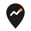
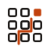

# Leadwalk brand guidelines

> **Walk in prepared.** · *Kapıdan hazırlıklı gir.*

Leadwalk is an open-source, local-first field-sales workspace. It finds the
businesses around you, ranks who most needs what you build, writes the opener
you walk in with, and tracks every visit to a yes. This document is the
single reference for how the brand looks and sounds. Every asset in this
folder is generated from `shared/brand.ts` by `tools/build-brand-kit.mjs`.

---

## 1. The name

**Leadwalk** = *lead* (a potential customer — already everyday sales vocabulary
in Turkish, "lead toplama") + *walk* (on foot, in person, along a route).

Why this name, in naming-psychology terms:

| Principle | How Leadwalk applies it | Source |
|---|---|---|
| Suggestive beats descriptive and abstract | Two real words that tell you what the product does without being a generic label ("LeadFinder"). Suggestive marks are also registrable; merely descriptive ones are not. | Igor Naming Guide; US trademark distinctiveness spectrum (Lanham Act §2(e)(1)) |
| Suggestive names lift recall of the promise | "Lead" + "walk" pre-loads the benefit: get to the right businesses, in person. | Keller, Heckler & Houston, *Journal of Marketing* 62(1), 1998 |
| Processing fluency | Two syllables, 8 letters, one spelling, high-frequency words — easy to say, judged more trustworthy. | Alter & Oppenheimer, *PNAS* 103, 2006 |
| Sound symbolism | Opens soft (/l/), closes on a hard stop (/k/): approachable, then decisive and solid. | Klink, *Marketing Letters*, 2000 |
| Category white space | Field-sales apps say *knock* (residential door-to-door), lead finders say *scrape/extract*, sales intelligence uses abstract words. Nobody owns *walk* for walk-in B2B prospecting. | Competitive scan, Nov 2026 |
| Works in both languages | Easy to pronounce in Turkish ("lid-vok"), no negative meaning. (Every *-pitch* candidate was rejected because "pitch" sounds like Turkish "piç".) | Cross-language screening |

**Writing the name:** `Leadwalk` — one word, capital L only. Never
"LeadWalk", "Lead Walk", "LEADWALK" (except in all-caps UI labels), or with a
trademark-style suffix.

**Domains** (RDAP check, 13 Nov 2026): leadwalk.dev, .app, .org, .net
unregistered; leadwalk.com registered (listed for sale). GitHub `leadwalk`
unclaimed. Before announcing, run a trademark knockout search for LEADWALK
(USPTO / EUIPO / TÜRKPATENT, Nice classes 9, 35, 42).

## 2. The mark

**L-Route to target.** A capital **L** drawn as a walked route — down the
street, one corner, along the block — arriving at a **target**: the lead,
inside its search radius. It is the whole product in one gesture: *find in a
radius → walk there → arrive prepared*.

- Built on a 64-unit grid; container corner radius 14 (≈ 22 %).
- Route stroke 7.5, round caps and joins; target ring 3.25; centre dot 3.75.
- Optically centred: the glyph's ink box is centred in the container.
- **Small sizes (< 48 px):** the ring is dropped and the dot grows to 5.5 — the
  favicon reads as a crisp "L." at 16 px.

### Concepts explored

| | Concept | Verdict |
|---|---|---|
|  | **A — L-Route to target** | Chosen. Monogram + meaning, survives 16 px, works knocked out. |
|  | B — Pin with path | Clear, but map pins are the most common icon in the category. |
|  | C — Storefront grid | Smart "scan the block" story; too busy below 32 px. |

Favicon test renders for each concept are in `concepts/*-16.png`, `-32.png`.

### Variants

| File | Use |
|---|---|
| `svg/symbol.svg` | Default: accent tile, white glyph |
| `svg/symbol-dark.svg` | On dark grounds: light accent tile, dark glyph |
| `svg/symbol-mono-black.svg` / `-mono-white.svg` | Single-colour print, embossing, fax-grade contexts — glyph is knocked out, no second colour needed |
| `svg/symbol-currentcolor.svg` | Inline in HTML; inherits CSS `color` |
| `svg/wordmark*.svg` | Name alone (Plus Jakarta Sans Bold, −1.5 % tracking, converted to outlines) |
| `svg/logo-horizontal*.svg` | Default lock-up: symbol = 1.5 × wordmark height, gap = 0.3 × symbol |
| `svg/logo-stacked*.svg` | Square formats: symbol above, centred |

### Don'ts

- Don't recolour the glyph inside the tile, add gradients, shadows or outlines.
- Don't rotate the L or move the target — the corner always turns right.
- Don't use the tile as a speech bubble, pin or other shape.
- Don't set the wordmark in another typeface or re-space it.
- Keep clear space of at least the target's diameter on every side.

## 3. Colour

| Token | Hex | Role |
|---|---|---|
| Route orange `accent` | `#C2410C` | Primary actions, the mark. Warm and energetic — the colour of approach, not alarm. 5.2 : 1 with white. |
| Route orange (dark) `accent-dark` | `#FB923C` | Accent on dark grounds |
| Ink | `#1C1917` | Text, wordmark |
| Paper | `#FBF8F4` | Light ground — warm, calm, readable outdoors |
| Night | `#141210` | Dark ground |
| Trust teal | `#0F766E` | "Won" and positive states only |
| Line | `#ECE6DE` | Hairlines, card borders |
| Muted | `#6B635B` | Secondary text (4.6 : 1 on paper) |

Pipeline stages: New `#A8A29E`, Prepared `#7C3AED`, Visited `#0369A1`,
Won `#0F766E`, Lost `#DC2626`. Stage colours always come with a text label —
they differ in lightness, never in hue alone.

The app follows the operating system's light/dark preference; both palettes
are defined as CSS tokens in `app/assets/css/main.css` and exported as W3C
design tokens in `tokens.json`.

## 4. Typography

**Plus Jakarta Sans** (SIL OFL 1.1), self-hosted via `@fontsource` — no
request to Google Fonts. Weights: 400 body, 600 labels, 700 headings and the
wordmark, 800 numbers and page titles. Numbers in tables and KPIs use tabular
figures. Body copy 15 px with 1.6–1.75 line height (pitch scripts are read on
a phone, outdoors, mid-walk).

## 5. Voice

Warm, respectful, concrete. Leadwalk helps you ask for a small, freely given
"yes" (a minute of attention) before anything bigger — the foot-in-the-door
principle, used kindly. No hype, no pressure, no fake urgency.

- ✅ "Who to visit today" · "Walk in prepared." · "Bugün kimi ziyaret etmeli"
- ❌ "Crush your quota!" · "AI-powered lead machine 🚀"

Taglines: **Walk in prepared.** / *Kapıdan hazırlıklı gir.* —
alt: **Every storefront is a lead.** / *Her vitrin bir müşteri adayı.*

## 6. Trademark

The source code is licensed under Apache-2.0, which (section 6) grants no
rights to the Leadwalk name or logo. Forks are welcome; please give them their
own name and mark.
